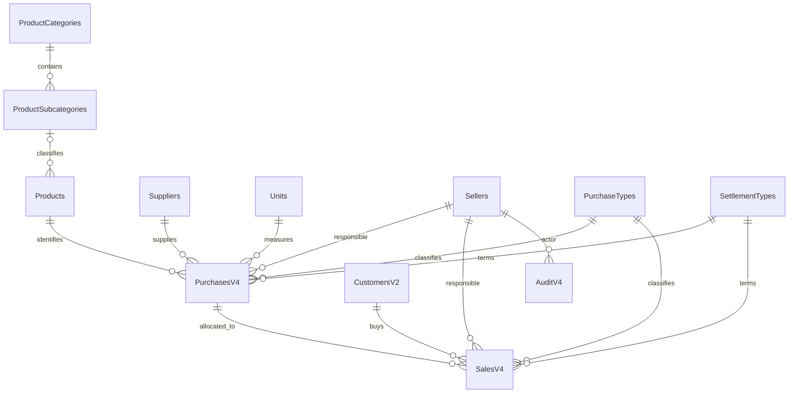

# 02 — Technical design

## Stack and components

SQL Server 2022 Standard, ODBC Driver 17, Windows integrated authentication, Python 3.12 environment, Streamlit, pandas, pyodbc, jdatetime, Decimal and JSON. Initial setup also included SQLAlchemy and python-dotenv; the inspected V1.3 runtime does not import them.

| File | Responsibility |
|---|---|
| app_v1.py | Navigation, CSS, master lookups, date parsing, forms, calculations, persistence, reports |
| database_v1.py | Connection and pandas query helper; STEEL_DB selects POC or PROD |
| migrate.sql | Incremental schema additions |
| master_prod.sql | Initial production seller, service and settlement seed |
| .streamlit/config.toml | Theme and Streamlit configuration |

## Logical model



AuditV4 uses Entity and RecordID as a polymorphic reference, not a foreign key to both transaction tables. Legacy tables remain: PurchaseInvoices, PurchaseItems, PurchaseServices, DealsV2, DealAuditV2. Services is not linked to current V4 purchases/sales.

## Data dictionary

| Table | Columns and types |
|---|---|
| Sellers | SellerID int identity PK; SellerName nvarchar(100) |
| Suppliers | SupplierID int identity PK; SupplierName nvarchar(200); IsActive bit default 1 |
| CustomersV2 | CustomerID int identity PK; CustomerName nvarchar(200) |
| Products | ProductID int identity PK; ProductCode nvarchar(50); ProductName nvarchar(200); UnitName nvarchar(30); IsActive bit; SubcategoryID nullable FK; SizeName nvarchar(100) nullable |
| ProductCategories | CategoryID int identity PK; CategoryName nvarchar(100) unique |
| ProductSubcategories | SubcategoryID int identity PK; CategoryID FK; SubcategoryName nvarchar(100); unique pair |
| Units | UnitID int identity PK; UnitName nvarchar(30) |
| PurchaseTypes | PurchaseTypeID int identity PK; TypeName nvarchar(50) |
| SettlementTypes | SettlementID int identity PK; SettlementName nvarchar(100) |
| Services | ServiceID int identity PK; ServiceName nvarchar(100); IsActive bit |
| PurchasesV4 | PurchaseID identity PK; InvoiceDate date; SupplierID, ProductID, UnitID, SellerID, PurchaseTypeID, SettlementID int FKs; shared fields below |
| SalesV4 | SaleID identity PK; PurchaseID FK; InvoiceDate date; CustomerID, SellerID, PurchaseTypeID, SettlementID int FKs; shared fields below |
| AuditV4 | AuditID identity PK; Entity nvarchar(20); RecordID int; ActorID FK; Reason nvarchar(500); OldData/NewData nvarchar(max); ChangedAt datetime2 default SYSDATETIME() |

Shared fields: Quantity decimal(18,3), Rate decimal(18,2), nullable legacy OfficialRate decimal(18,2), Version rowversion, ManualInvoiceNo nvarchar(50) nullable, Notes nvarchar(2000) nullable, Quantity2 decimal(18,3) nullable, Rate2 decimal(18,2) nullable, computed TotalQuantity and TotalAmount. There is **no IsDualRate column** in the actual migration; a non-null Quantity2 represents the second line. OfficialRate is retained but not used by the current editor. SQL metadata max_length for nvarchar is bytes, not characters.

## Calculations

```text
Q = Q1 + coalesce(Q2, 0)
A = Q1 × R1 + coalesce(Q2 × R2, 0)
Remaining = Purchase.Q − sum(linked Sales.Q)
WeightedPurchaseRate = Purchase.A / Purchase.Q
AllocatedCost = Sale.Q × WeightedPurchaseRate
Spread = Sale.A − AllocatedCost
```

Example: 6,000 kg at 30,000 plus 4,000 kg at 35,000 yields 10,000 kg and 320,000,000 monetary units. Selling 5,000 kg at 40,000 yields revenue 200,000,000, allocated cost 160,000,000, spread 40,000,000 and remaining stock 5,000 kg. Currency and rounding policy still need formal confirmation. Spread excludes services, overhead, tax and other costs.

## Transaction integrity

The `persist` function opens a non-autocommit connection, locks the parent purchase using UPDLOCK/HOLDLOCK, checks total linked sales excluding the edited sale, and rejects overselling or a sale before its purchase. Purchase edits cannot reduce quantity below sold quantity, move date after the first sale, or change product/unit when sales exist. Updates use `WHERE PK=? AND Version=?`; zero affected rows triggers a stale-record error. Audit insertion and update share one transaction. Exceptions roll back; connections close in finally blocks. These checks protect app-mediated writes; direct SQL can bypass cross-row rules.

## Dates and UI

Invoice dates require YYYY/MM/DD with exactly two-digit month/day; Persian and Arabic digits are normalized and jdatetime validates calendar dates. Invoice dates are stored Gregorian. Settlement date is optional and encoded as a tagged first line of Notes (`[تاریخ تسویه: YYYY/MM/DD]`), not a typed SQL column. Notes capacity is checked in UTF-16 code units. The UI does not enforce cash/credit date consistency.

Navigation: purchase, sale, remaining purchases, transaction report, correction, audit, master data. The report joins sales to purchases and displays dates, parties, product, unit, weighted rates, amounts, spread, seller, office numbers and notes; CSV uses UTF-8 BOM. Open purchases are separate from the sales report. The palette uses #101e30, #172b4d, #d8b477, white and light neutrals. CSS hides Deploy/menu but preserves sidebar reopening; these selectors depend on Streamlit internals.
